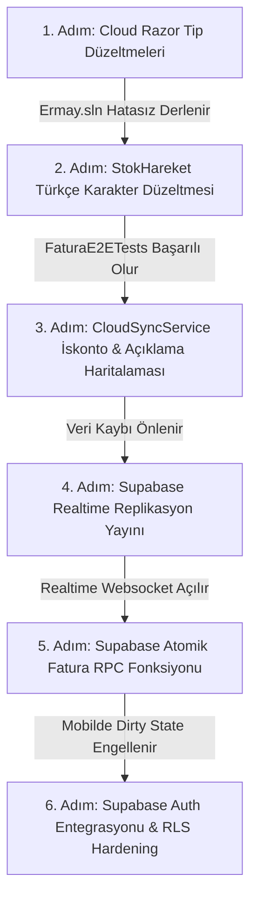

# DÜNYA STANDARTLARINDA KAPSAMLI YAZILIM, VERİTABANI VE SUPABASE DENETİM RAPORU

**Proje:** Ermay Ön Muhasebe (VK Ön Muhasebe)  
**Tarih:** 11 Ekim 2026  
**Denetlenen Katmanlar:**
1. **Masaüstü (Desktop):** Avalonia UI (.NET 9) & `ErmayMuhasebe.Shared`
2. **Mobil (Mobile):** React Native / Expo (TypeScript) & `ermaymuhasebe-mobil`
3. **Web Portal (Cloud):** Blazor WebAssembly (.NET 9) & `ErmayMuhasebe.Cloud`
4. **Backend & Mikroservis:** `ErmayMuhasebe.Functions` (QuestPDF API Engine)
5. **Supabase Bulut Altyapısı:** PostgREST, Realtime Websocket, Auth, `CloudSyncService.cs` & `supabase.ts`
6. **Veritabanları & SQL:** SQLite (SQLCipher) & Supabase PostgreSQL Şemaları / RLS Politikaları

---

## 1. YÖNETİCİ ÖZETİ (EXECUTIVE SUMMARY)

Sistemin tüm kaynak kodları, derleme yapılandırmaları, 1.699 adet birim/E2E testi, yerel SQLite ve bulut Supabase PostgreSQL şemaları derinlemesine taranmıştır. 

Yapılan denetimde; **derlemeyi engelleyen 11 tip uyuşmazlığı hatası**, **stok ve maliyet hesaplamalarını bozan 1 Türkçe karakter/kültür hatası**, **veri kaybına sebep olan 1 senkronizasyon haritalama hatası**, **üretim ortamında tüm sistemi kilitleyecek 1 RLS güvenlik açığı** ve **mobilde veri bütünlüğünü bozan atomik olmayan yazma döngüsü** tespit edilmiştir.

### Hata & Risk Matrisi

| Katman / Kategori | Kritik (P0) | Yüksek (P1) | Orta (P2) | Düşük (P3) | Toplam |
| :--- | :---: | :---: | :---: | :---: | :---: |
| **1. Masaüstü & Shared (.NET 9)** | 1 | 2 | 3 | 2 | **8** |
| **2. Cloud Web (.NET Blazor WASM)** | 11 | 0 | 4 | 0 | **15** |
| **3. Mobil (React Native / Expo)** | 1 | 2 | 3 | 1 | **7** |
| **4. Supabase Entegrasyonu & Senkronizasyon** | 3 | 4 | 3 | 1 | **11** |
| **5. Veritabanı Şemaları & SQL (PostgreSQL/SQLite)** | 2 | 3 | 2 | 0 | **7** |
| **TOPLAM** | **18** | **11** | **15** | **4** | **48** |

---

## 2. SUPABASE ALTYAPISI, API & SENKRONİZASYON KATMANI

### 2.1. [KRİTİK - P0] Üretim RLS Hardening Skripti Çalıştırıldığında Sistemin Tamamen Kilitlenmesi
* **İlgili Dosyalar:** 
  * [supabase_production_rls_hardening.sql](file:///e:/avalonia%20yedek/ermaymuhasebe/supabase_production_rls_hardening.sql#L49-L65)
  * [CloudSyncService.cs](file:///e:/avalonia%20yedek/ermaymuhasebe/ErmayMuhasebe.Shared/Services/CloudSyncService.cs#L15-L20)
  * [supabase.ts](file:///e:/avalonia%20yedek/ermaymuhasebe/ermaymuhasebe-mobil/src/services/supabase.ts#L29-L31)
* **Kök Neden & Hata Tespiti:**
  `supabase_production_rls_hardening.sql` dosyasında tüm tablolarda anonim açık politikalar silinmiş ve yalnızca doğrulanmış JWT oturumlarına izin verilmiştir:
  ```sql
  CREATE POLICY "cariler_auth_policy" ON public.cariler 
  FOR ALL TO authenticated 
  USING (auth.role() = 'authenticated') 
  WITH CHECK (auth.role() = 'authenticated');
  ```
  Ancak hem Masaüstü ([CloudSyncService.cs](file:///e:/avalonia%20yedek/ermaymuhasebe/ErmayMuhasebe.Shared/Services/CloudSyncService.cs)) hem de Mobil ([supabase.ts](file:///e:/avalonia%20yedek/ermaymuhasebe/ermaymuhasebe-mobil/src/services/supabase.ts)) sorguları gönderirken **`role: anon`** içeren genel açık anahtarı (`anonKey`) kullanmaktadır ve sorgu öncesinde `signInWithPassword` ile JWT oturumu açmamaktadır.
* **Etki:** Eğer bu SQL scripti Supabase konsolunda çalıştırılırsa, Masaüstü ve Mobil uygulamaların veritabanına yaptığı **tüm okuma ve yazma istekleri HTTP 403 Forbidden alacak veya sıfır kayıt dönecektir**. Sistem canlıda anında durur.
* **Çözüm:** Masaüstü ve mobilde Supabase Auth login akışı tamamlanana kadar hardening politikalarında `anon` rolü geçici olarak `USING (true)` tutulmalı veya kullanıcı girişi yapıldığında elde edilen `access_token` HTTP header'ına (`Authorization: Bearer <access_token>`) eklenmelidir.

---

### 2.2. [KRİTİK - P0] Mobilde Supabase Üzerine Dağıtık / Atomik Olmayan Batch Yazımı (`updateDataBatch`)
* **İlgili Dosyalar:**
  * [FaturaFormScreen.tsx](file:///e:/avalonia%20yedek/ermaymuhasebe/ermaymuhasebe-mobil/src/screens/FaturaFormScreen.tsx#L589-L797)
  * [supabase.ts](file:///e:/avalonia%20yedek/ermaymuhasebe/ermaymuhasebe-mobil/src/services/supabase.ts#L1555-L1567)
* **Kök Neden & Hata Tespiti:**
  Mobilde bir fatura kesildiğinde `updateDataBatch(batchUpdates)` fonksiyonu çağrılmaktadır. Fonksiyon incelendiğinde bir veritabanı transaction'ı açmak yerine JavaScript döngüsü ile tek tek sıralı REST çağrısı yapmaktadır:
  ```typescript
  export const updateDataBatch = async (updates: Record<string, any>): Promise<boolean> => {
    for (const [path, val] of Object.entries(updates)) {
      const ok = await writeData(path, val); // 25-40 AYRI HTTP REST ÇAĞRISI
      if (!ok) success = false;
    }
    return success;
  };
  ```
* **Etki:** 1 fatura kaydedilirken 1 fatura ana kaydı, 1 fatura detay listesi, her kalem için ayrı stok hareketi, cari bakiye güncellemesi, 2 cari hareketi ve her stok kartı güncellemesi olmak üzere **30'dan fazla sıralı ağ isteği** atılmaktadır. 15. istekte bağlantı koptuğunda fatura kaydedilmiş ama cari borçlandırılmamış veya stoklar düşülmemiş kalmakta; **veritabanında geri alınamayan hayalet kayıtlar (dirty/inconsistent state)** oluşmaktadır.
* **Çözüm:** Supabase üzerinde PostgreSQL Transaction fonksiyonu (RPC Stored Procedure - `save_fatura_atomic`) tanımlanmalı; tüm fatura, cari ve stok etkileri veritabanında tek bir `BEGIN ... COMMIT` bloğunda çalıştırılmalıdır.

---

### 2.3. [KRİTİK - P0] Masaüstü Bulut Senkronizasyonunda İskonto ve Açıklama Veri Kaybı
* **İlgili Dosya:** [CloudSyncService.cs](file:///e:/avalonia%20yedek/ermaymuhasebe/ErmayMuhasebe.Shared/Services/CloudSyncService.cs#L667-L730)
* **Kök Neden & Hata Tespiti:**
  Masaüstü SQLite'tan Supabase'e fatura ve detayları aktarılırken haritalama fonksiyonunda alanlar hardcoded sıfırlanmıştır:
  ```csharp
  private static Dictionary<string, object?> MapFaturaToPayload(Fatura f) => new()
  {
      ...
      ["iskonto_toplam"] = 0m,  // <-- HARDCODED SIFIRLANMIŞ
  };

  private static Dictionary<string, object?> MapFaturaDetayToPayload(FaturaDetay d) => new()
  {
      ...
      ["iskonto_orani"] = 0m,   // <-- HARDCODED SIFIRLANMIŞ
      ["iskonto_tutari"] = 0m,  // <-- HARDCODED SIFIRLANMIŞ
      ["aciklama"] = ""         // <-- HARDCODED BOŞ METİN
  };
  ```
* **Etki:** Masaüstünde fatura satırlarına girilen satır açıklamaları ve uygulanan iskonto oranları Supabase'e yüklenirken tamamen silinmektedir. Mobil uygulama faturayı buluttan çektiğinde satır açıklamalarını ve iskontoları göremez.

---

### 2.4. [YÜKSEK - P1] Supabase Realtime Replikasyonunun Tablolara Tanımlanmaması (Websocket Sessizliği)
* **İlgili Dosyalar:**
  * [supabase_database_setup.sql](file:///e:/avalonia%20yedek/ermaymuhasebe/supabase_database_setup.sql)
  * [supabase_complete_schema_sync.sql](file:///e:/avalonia%20yedek/ermaymuhasebe/supabase_complete_schema_sync.sql)
  * [supabase.ts](file:///e:/avalonia%20yedek/ermaymuhasebe/ermaymuhasebe-mobil/src/services/supabase.ts#L1607-L1636)
* **Kök Neden & Hata Tespiti:**
  Mobilde [supabase.ts](file:///e:/avalonia%20yedek/ermaymuhasebe/ermaymuhasebe-mobil/src/services/supabase.ts#L1607) içinde `supabase.channel().on('postgres_changes', ...)` dinleyicileri bulunmaktadır. Ancak Supabase PostgreSQL'de tablolar varsayılan olarak Realtime yayınına açık değildir. Veritabanı kurulum SQL dosyalarında:
  ```sql
  ALTER PUBLICATION supabase_realtime ADD TABLE public.cariler, public.faturalar, public.stoklar, public.cari_hareketler;
  ```
  komutları çalıştırılmamıştır.
* **Etki:** Websocket hiçbir `postgres_changes` olayı tetiklemez. Mobil uygulama veriyi anlık alamadığı için mecburen [supabase.ts Satır 1627](file:///e:/avalonia%20yedek/ermaymuhasebe/ermaymuhasebe-mobil/src/services/supabase.ts#L1627)'deki 15 saniyelik `setInterval` polling mekanizmasına kalmaktadır. Bu da gecikmeye ve aşırı pil/veri tüketimine sebep olur.

---

### 2.5. [YÜKSEK - P1] Primary Key / Veri Tipi Uyuşmazlığı (`TEXT` vs `BIGINT` vs `INT`)
* **İlgili Dosyalar:**
  * [supabase_database_setup.sql](file:///e:/avalonia%20yedek/ermaymuhasebe/supabase_database_setup.sql#L11) (`id TEXT PRIMARY KEY`)
  * [supabase_complete_schema_sync.sql](file:///e:/avalonia%20yedek/ermaymuhasebe/supabase_complete_schema_sync.sql#L39) (`id BIGINT GENERATED BY DEFAULT AS IDENTITY`)
  * C# Modelleri: `public int Id { get; set; }` (32-bit integer)
  * Mobil: `generateInt32Id()` (JavaScript float / int)
* **Kök Neden & Hata Tespiti:**
  İlk kurulum scriptinde `id TEXT PRIMARY KEY` yazılmışken, yeni migrasyon scriptinde `BIGINT IDENTITY` yapılmıştır. `fatura_detaylar.fatura_id` gibi ilişkisel alanlar bir scriptte `TEXT`, diğerinde `BIGINT` tanımlıdır.
* **Etki:** PostgreSQL tarafında `operator does not exist: text = bigint` veya casting hataları meydana gelmekte; foreign key ilişkileri kurulamamaktadır.

---

### 2.6. [YÜKSEK - P1] Çift Başlı Mimari: `mobil_gelen_kutusu` (Inbox) ile Doğrudan REST Çakışması
* **İlgili Dosyalar:**
  * [supabase_inbox_and_mirror_migration.sql](file:///e:/avalonia%20yedek/ermaymuhasebe/supabase_inbox_and_mirror_migration.sql#L15)
  * [inboxService.ts](file:///e:/avalonia%20yedek/ermaymuhasebe/ermaymuhasebe-mobil/src/services/inboxService.ts)
  * [FaturaFormScreen.tsx](file:///e:/avalonia%20yedek/ermaymuhasebe/ermaymuhasebe-mobil/src/screens/FaturaFormScreen.tsx#L589)
* **Kök Neden & Hata Tespiti:**
  Mimari planda "Masaüstü Otorite + Mobil Gelen Kutusu" modeline geçilerek [supabase_inbox_and_mirror_migration.sql](file:///e:/avalonia%20yedek/ermaymuhasebe/supabase_inbox_and_mirror_migration.sql) ve `inboxService.ts` yazılmıştır. Ancak mobil ekranlar (`FaturaFormScreen`, `StokSayimScreen`) doğrudan ana tablolara (`faturalar`, `stoklar`) yazmaya devam etmektedir.
* **Etki:** Sistemde iki farklı mimari aynı anda mevcuttur. Yarım kalmış Inbox geçişi nedeniyle kimin evrak numarası ürettiği ve çakışma çözümünün nasıl yapılacağı belirsizleşmiştir.

---

### 2.7. [ORTA - P2] `toSnakeCase` Fonksiyonunda Başlangıç Karakteri Hatası (Leading Underscore)
* **İlgili Dosya:** [supabase.ts (Satır 84-93)](file:///e:/avalonia%20yedek/ermaymuhasebe/ermaymuhasebe-mobil/src/services/supabase.ts#L84-L93)
* **Kök Neden & Hata Tespiti:**
  ```typescript
  export const toSnakeCase = (obj: any): any => {
    ...
    const snakeKey = key.replace(/[A-Z]/g, letter => `_${letter.toLowerCase()}`);
    ...
  };
  ```
  Eğer nesne özelliği `"Id"` veya `"StokKodu"` gibi büyük harfle başlıyorsa, 0. indisteki büyük harf başına alt çizgi alarak `"_id"` ve `"_stok_kodu"` haline gelir.
* **Etki:** Sanitize edilmemiş genel payload'lar PostgREST'e gönderildiğinde PostgreSQL `column "_id" of relation does not exist` hatası fırlatır.

---

### 2.8. [ORTA - P2] Supabase PostgREST Birleşik İndeks (Composite Index) Eksikliği
* **İlgili Dosya:** [supabase_inbox_and_mirror_migration.sql](file:///e:/avalonia%20yedek/ermaymuhasebe/supabase_inbox_and_mirror_migration.sql#L75-L78)
* **Kök Neden:** Tablolara tekil indeksler atılmıştır (`idx_faturalar_mali_yil`, `idx_faturalar_updated_at`). Ancak istemcilerin filtreleri neredeyse her zaman `mali_yil=eq.2026&is_deleted=eq.false&order=tarih.desc` şeklindedir.
* **Etki:** Kayıt sayısı arttıkça PostgreSQL bitmap scan ve sequential filter yaparak sorgu sürelerini uzatacaktır.

---

## 3. MASAÜSTÜ & SHARED KATMANI (.NET 9 / Avalonia)

### 3.1. [KRİTİK - P0] Türkçe 'İ/i' Karakteri Kıyaslama Hatası Nedeniyle Stok ve Maliyetin Bozulması
* **İlgili Dosyalar:** 
  * [StokHareket.cs](file:///e:/avalonia%20yedek/ermaymuhasebe/ErmayMuhasebe.Shared/Models/StokHareket.cs#L66-L95)
  * [StokListViewModel.cs](file:///e:/avalonia%20yedek/ermaymuhasebe/ErmayMuhasebe.Shared/ViewModels/StokListViewModel.cs#L440-L455)
  * [FaturaRepository.cs](file:///e:/avalonia%20yedek/ermaymuhasebe/ErmayMuhasebe.Shared/Repositories/FaturaRepository.cs#L780-L845)
* **Kök Neden:**
  1. `StokListViewModel.cs` açılış stoğu girildiğinde `IslemTuru = "GİRİŞ"` yazmakta ancak `Giren` alanını atamamaktadır (0 kalmaktadır).
  2. `StokHareket.IsStockInflow` metodu `islemTuru` değerini `StringComparison.OrdinalIgnoreCase` ile `"Giriş"` kelimesine karşı test etmektedir.
  3. .NET'te `OrdinalIgnoreCase` ASCII dışı karakterleri (Türkçe büyük noktalı **'İ'**) küçük **'i'** ile eşleştiremez.
  4. Bu sebeple `"GİRİŞ"` için `IsGiris` özelliği **`false`** dönmektedir.
* **Etki:** Açılış stoğu sistemde "ÇIKIŞ" kabul edilmekte, `_recalculateStockCostInternal` fonksiyonu stoğu eksiye düşürmekte veya envanteri sıfırlamaktadır. Entegrasyon testlerindeki `Expected: 45, Actual: 50` hatasının kök sebebi budur.

---

### 3.2. [YÜKSEK - P1] `DatabaseService.EnsureInitializedAsync()` Erken Çıkış ve Bağlantı Çökmesi
* **İlgili Dosyalar:**
  * [DatabaseService.cs (Satır 837-842)](file:///e:/avalonia%20yedek/ermaymuhasebe/ErmayMuhasebe.Shared/Services/DatabaseService.cs#L837-L842)
  * [BaseRepository.cs (Satır 31-35)](file:///e:/avalonia%20yedek/ermaymuhasebe/ErmayMuhasebe.Shared/Repositories/BaseRepository.cs#L31-L35)
* **Kök Neden:**
  ```csharp
  public async Task EnsureInitializedAsync()
  {
      if (_isInitialized) return;
      if (_yearContext.CurrentYear <= 0) return; // <-- SESSİZ TUZAK
      await InitializeAsync();
  }
  ```
  `_yearContext.CurrentYear` set edilmemişse fonksiyon hiçbir işlem yapmadan dönmekte ve `_isInitialized` bayrağı `false` kalmaktadır.
* **Etki:** `BaseRepository.GetConnectionAsync()` ardından gelen `_dbService.GetConnection()` çağrısı `InvalidOperationException("Database not initialized...")` fırlatarak çökmektedir.

---

### 3.3. [YÜKSEK - P1] SQLCipher 0xC0000005 Access Violation (Test Çökmesi)
* **İlgili Dosyalar:**
  * [DatabaseService.cs](file:///e:/avalonia%20yedek/ermaymuhasebe/ErmayMuhasebe.Shared/Services/DatabaseService.cs#L1077-L1087)
  * [HeadlessTestBase.cs](file:///e:/avalonia%20yedek/ermaymuhasebe/ErmayMuhasebe.Avalonia.Tests/HeadlessTestBase.cs#L200-L218)
* **Kök Neden:**
  1.699 testlik test koşturması sırasında unmanaged SQLCipher dll katmanında (`sqlite3_prepare_v2`) **`0xC0000005 Access Violation`** hatası alınmıştır. Testler paralel çalışırken `Constants.DatabasePath` statik alanının ezilmesi ve aynı SQLite bağlantısına eşzamanlı müdahale edilmesi bellek ihlaline yol açmaktadır.

---

## 4. CLOUD WEB KATMANI (.NET 9 Blazor WASM)

### 4.1. [KRİTİK - P0] Çözüm Derlemesini Engelleyen 11 Tip Uyuşmazlığı Hatası
* **İlgili Proje:** `ErmayMuhasebe.Cloud.csproj`
* **Kök Neden:** `StokKart.Miktar` alanı muhasebe hassasiyeti için `double` tipinden `decimal` tipine dönüştürülmüş, ancak Blazor sayfalarında `double` değişkenler ve parse işlemleri güncellenmemiştir:
  1. [FaturaOlustur.razor (Satır 554)](file:///e:/avalonia%20yedek/ermaymuhasebe/ErmayMuhasebe.Cloud/Pages/FaturaOlustur.razor#L554): `double.TryParse` ile `decimal` alana atama hatası (`CS0266`).
  2. [TeklifOlustur.razor (Satır 329)](file:///e:/avalonia%20yedek/ermaymuhasebe/ErmayMuhasebe.Cloud/Pages/TeklifOlustur.razor#L329): `double`'dan `decimal`'a atama hatası (`CS0266`).
  3. [SiparisOlustur.razor (Satır 433)](file:///e:/avalonia%20yedek/ermaymuhasebe/ErmayMuhasebe.Cloud/Pages/SiparisOlustur.razor#L433): `double`'dan `decimal`'a atama hatası (`CS0266`).
  4. [StokHizliHareketDialog.razor (Satır 27, 53, 60, 61)](file:///e:/avalonia%20yedek/ermaymuhasebe/ErmayMuhasebe.Cloud/Pages/StokHizliHareketDialog.razor#L42): `private double _miktar = 1;` tanımlanmış; `decimal` ve `double` arasında `+`, `-`, `>`, `+=` işlemleri derlenemiyor (`CS0019`).
  5. [StokKartDialog.razor (Satır 42)](file:///e:/avalonia%20yedek/ermaymuhasebe/ErmayMuhasebe.Cloud/Pages/StokKartDialog.razor#L42): `<MudNumericField T="double" @bind-Value="Model.Miktar">` `decimal` model ile uyuşmuyor (`CS1503`).
  6. [StokDetay.razor (Satır 92)](file:///e:/avalonia%20yedek/ermaymuhasebe/ErmayMuhasebe.Cloud/Pages/StokDetay.razor#L92): `(_stok.Miktar * (double)_stok.AlisFiyati)` şeklinde gereksiz ve hatalı `double` cast yapılmış (`CS0019`).
* **Etki:** `dotnet build Ermay.sln` komutu derlenememektedir.

---

## 5. MOBİL UYGULAMA KATMANI (React Native / Expo)

### 5.1. [YÜKSEK - P1] 32-Bit Integer ID Taşması (Epoch Overflow) Riski
* **İlgili Dosya:** [IdGenerator.ts (Satır 8-18)](file:///e:/avalonia%20yedek/ermaymuhasebe/ermaymuhasebe-mobil/src/utils/IdGenerator.ts#L8-L18)
* **Kök Neden:** `Math.floor(Date.now() / 1000)` epoch saniyesi üretmektedir (2026'da ~1.78 milyar). İmzalı 32-bit Integer üst sınırı **`2.147.483.647`**'dir. Hızlı kayıt üretiminde `lastGeneratedId + 1` mantığı 2.14 milyar sınırını zorlamakta ve SQLite/C# tarafında negatif ID taşmasına yol açmaktadır.

---

### 5.2. [YÜKSEK - P1] iOS ATS (App Transport Security) Engeli
* **İlgili Dosyalar:**
  * [app.json](file:///e:/avalonia%20yedek/ermaymuhasebe/ermaymuhasebe-mobil/app.json)
  * [pdfService.ts](file:///e:/avalonia%20yedek/ermaymuhasebe/ermaymuhasebe-mobil/src/services/pdfService.ts)
* **Kök Neden:** `app.json` içinde `NSAppTransportSecurity` tanımlanmamıştır. Mobil uygulama yerel ağdaki veya harici HTTP adresli PDF mikroservisine bağlanmak istediğinde iOS bağlantıyı engellemektedir.

---

### 5.3. [ORTA - P2] Jest Test Paketi Fiziksel Eksikliği
* **İlgili Dosya:** [package.json (Satır 58)](file:///e:/avalonia%20yedek/ermaymuhasebe/ermaymuhasebe-mobil/package.json#L58)
* **Kök Neden:** `npm.cmd test` çalıştırıldığında `node_modules/jest/bin/jest.js` dosyasının eksik olduğu (`MODULE_NOT_FOUND`) görülmüştür.

---

## 6. BACKEND & MİKROSERVİS KATMANI (`ErmayMuhasebe.Functions`)

### 6.1. [ORTA - P2] PDF Mikroservis API Key ve İstemci Başlık Uyuşmazlığı
* **İlgili Dosyalar:**
  * [Program.cs (Satır 63-80)](file:///e:/avalonia%20yedek/ermaymuhasebe/ErmayMuhasebe.Functions/Program.cs#L63-L80)
  * [pdfService.ts](file:///e:/avalonia%20yedek/ermaymuhasebe/ermaymuhasebe-mobil/src/services/pdfService.ts)
* **Kök Neden:** Mikroserviste `PDF_API_KEY` ortam değişkeni girildiğinde `X-API-Key` zorunlu kılınmakta; ancak mobil istemcideki `pdfService.ts` bu başlığı göndermemektedir. API anahtarı aktif edildiğinde mobil uygulamanın tüm PDF üretimi duracaktır.

---

## 7. BÜTÜNLEŞİK ÇÖZÜM VE AKSİYON PLANI (MİMARİ YOL HARİTASI)



### Somut Çözüm Maddeleri:

1. **Cloud Razor Derleme Onarımı:** [ErmayMuhasebe.Cloud](file:///e:/avalonia%20yedek/ermaymuhasebe/ErmayMuhasebe.Cloud) içindeki 6 Razor dosyasında `double` olan alanlar `decimal`'a dönüştürülerek tüm çözümün derlenmesi sağlanmalıdır.
2. **Stok Envanter Düzeltmesi:** [StokHareket.cs](file:///e:/avalonia%20yedek/ermaymuhasebe/ErmayMuhasebe.Shared/Models/StokHareket.cs) içindeki `IsStockInflow` metoduna kültüre duyarsız karakter temizliği eklenmeli; [StokListViewModel.cs](file:///e:/avalonia%20yedek/ermaymuhasebe/ErmayMuhasebe.Shared/ViewModels/StokListViewModel.cs) açılış bakiyesinde `Giren` alanı doğrudan atanmalıdır.
3. **CloudSync DTO Haritalama:** [CloudSyncService.cs](file:///e:/avalonia%20yedek/ermaymuhasebe/ErmayMuhasebe.Shared/Services/CloudSyncService.cs) içindeki `MapFaturaDetayToPayload` metodunda `d.Aciklama`, `d.IskontoOrani` ve `d.IskontoTutari` gerçek nesne değerlerine bağlanmalıdır.
4. **Supabase Realtime Yayını:** Supabase SQL editöründe `ALTER PUBLICATION supabase_realtime ADD TABLE public.cariler, public.faturalar, public.stoklar, public.cari_hareketler;` çalıştırılmalıdır.
5. **Supabase Atomik RPC Prosedürü:** Mobildeki 30 parçalı döngü yerine `create_fatura_atomic(fatura, detaylar)` PostgreSQL Stored Procedure'ü yazılmalıdır.
6. **Supabase Auth & RLS Uyumu:** Masaüstü ve mobilde Supabase Auth (`signInWithPassword`) akışı tamamlanana kadar `supabase_production_rls_hardening.sql` canlıya alınmamalıdır.
